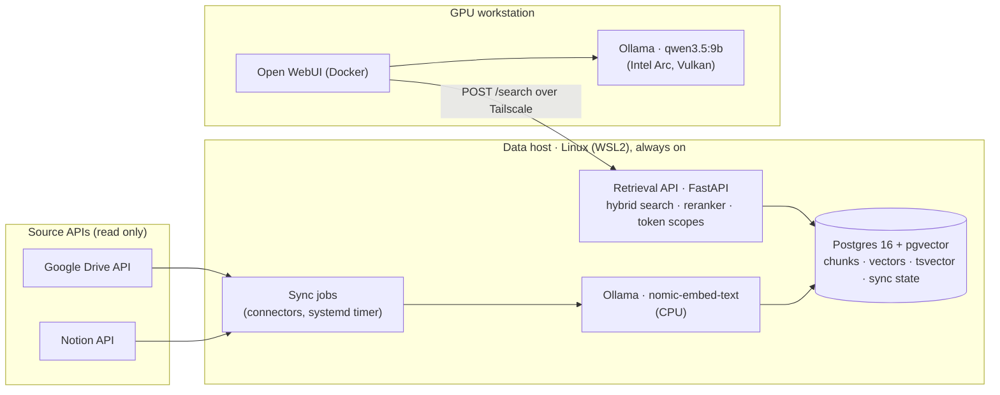
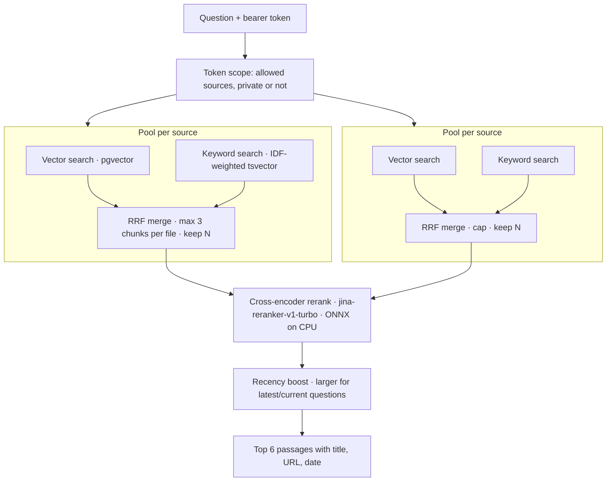

# Architecture

A private retrieval-augmented generation (RAG) system over one person's Notion workspace and Google Drive. Documents are indexed ahead of time on an always-on **data host**; a local chat model on a **GPU workstation** answers questions from the retrieved passages and cites them. Nothing is sent to a hosted model.

## Design rules

1. **Ingest ahead of time, retrieve locally.** Sources are read only by scheduled syncs, never during a question.
2. **One schema, many connectors.** Every source becomes a LangChain `Document` with the same metadata.
3. **Config over code.** Sources, folders, models, tokens and schedules live in YAML and `.env`; no personal IDs in code.
4. **Read-only by construction.** No code path writes to a source system.
5. **Measure before changing.** Every retrieval change is run against the eval set and kept or reverted on the numbers.
6. **Private data stays on owned hardware.** Access is enforced by API token scopes, not by prompt.

## Topology

| Host | Runs | Why there |
|---|---|---|
| Data host | Postgres + pgvector, Ollama (embeddings), retrieval API, sync jobs | Disk and uptime; the sensitive data stays on one box |
| GPU workstation | Open WebUI, Ollama (chat model) | The GPU makes answer generation about 10x faster than CPU |

The hosts talk only over Tailscale. The API listens on localhost and the Tailscale address and requires a bearer token.

## Ingestion

1. **Connector** (`second_brain/connectors/`) yields new or changed `Document`s and deletions since a saved cursor: Notion `last_edited_time`, the Drive Changes API page token, or file modification time for local files.
2. **Metadata contract** (`models.py`): source, source_id, title, url, dates and `sensitivity` are validated with pydantic.
3. **Chunking** (`chunking.py`): split on Markdown headings, then to ~400 tokens with 50 overlap; each chunk is prefixed with its title and heading path.
4. **Embedding**: Ollama `nomic-embed-text` (768 dimensions) with document and query prefixes.
5. **Indexing** (`sync.py`): LangChain `index()` with `SQLRecordManager` adds new chunks, skips unchanged ones and removes stale ones. The cursor is saved only after the whole batch succeeds.

| Table | Owner | Holds |
|---|---|---|
| `langchain_pg_embedding` | langchain-postgres `PGVector` | Chunk text, vector, JSONB metadata, stored `fts` tsvector with a GIN index |
| `langchain_pg_collection` | langchain-postgres | One collection per instance and embedding model |
| `upsertion_record` | `SQLRecordManager` | Chunk hashes per document, for incremental updates |
| `sync_state` | this project | Per-source cursor, last success, last error, document count |

## Retrieval (`POST /search`)

| Setting (`config/settings.yaml`) | Default | Effect |
|---|---|---|
| `mode` | `hybrid_rerank` | Vector + keyword search, then the reranker |
| `candidates` | 20 | Chunks kept per source before reranking |
| `max_chunks_per_doc` | 3 | Stops one long file from filling a pool |
| `recency_weight` / `recency_weight_temporal` | 0.2 / 1.0 | Freshness bonus; the larger one when the question asks for the latest |
| `top_k` | 6 | Passages returned to the model |

## Security and privacy

| Threat | Control |
|---|---|
| Private data reaching hosted models | Tokens carry `allowed_sources` and `include_private`; both searches filter on them |
| Network exposure | Tailscale only; bearer token on every request |
| Prompt injection from documents | No write tools exist; the answer prompt treats passages as data |
| Over-broad source access | Read-only OAuth scope; Drive limited to listed folders; Notion limited to pages shared with the integration |
| Personal data in Git | Real config, tokens and eval questions are gitignored; only `.example` files are committed |

## Not built yet

An agentic retry loop (LangGraph), an MCP server for other AI clients, Gmail, Outlook and SMS connectors, OCR for scanned PDFs, and stale-source alerts.
